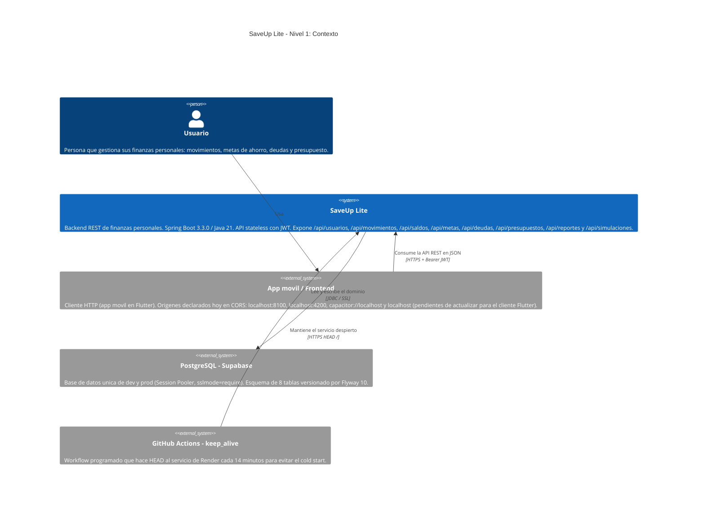

# 01 — Diagrama de contexto (C4 Nivel 1)

**Tipo mermaid:** `C4Context` · **Estado:** completo (verificado contra el código en HEAD `446a9f5`)

## Qué responde
Quién usa SaveUp Lite, qué es el sistema como caja negra y con qué sistemas externos reales se relaciona.

## Fuentes
- `.agents/rules/00-contexto-proyecto.md` (BD: Supabase PostgreSQL en dev y prod)
- `src/main/resources/application-dev.properties` y `application-prod.properties`
- `.github/workflows/keep_alive.yml`
- `src/main/java/com/example/saveup/config/SecurityConfig.java` (API stateless + JWT)
- `docs/CONTEXT.md`

## Diagrama

## Notas y "por confirmar"
- La API es **stateless**: `SecurityConfig` fija `SessionCreationPolicy.STATELESS`, `csrf` deshabilitado y todo endpoint salvo `register`, `login`, `OPTIONS` y `GET/HEAD /` exige JWT válido.
- Los **reportes** (PDF/CSV) se generan dentro de la misma aplicación (`service.report`), sobre `byte[]` en memoria; no hay sistema externo de reporting.
- Las **simulaciones** (`POST /api/simulaciones/credito`) no tocan la base de datos: `SimulacionService` solo ejecuta el motor financiero y devuelve un DTO.
- El **cliente frontend no vive en este repositorio**; solo se conocen sus orígenes por `app.cors.allowed-origins`.
- Discrepancia documentada: `docs/diagramas/README.md` recoge que el plan C4 previo (`saveup-lite-c4.md`) describía **Oracle** como motor de desarrollo, lo que el código actual ya no refleja (dev y prod usan PostgreSQL/Supabase).
