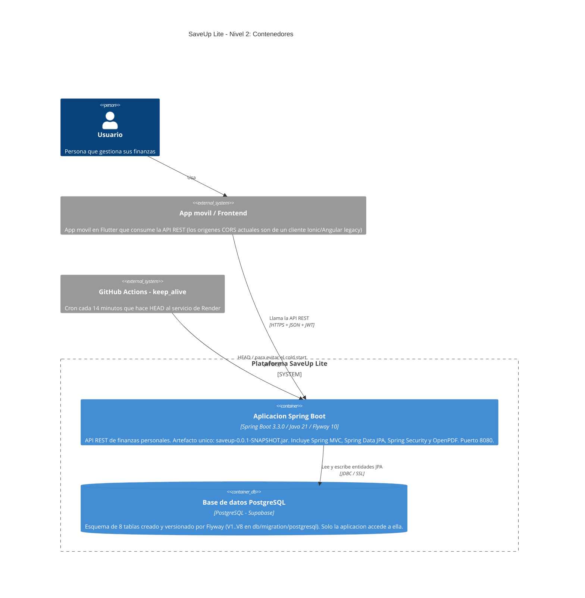

# 02 — Diagrama de contenedores (C4 Nivel 2)

**Tipo mermaid:** `C4Container` · **Estado:** completo (verificado contra el código en HEAD `446a9f5`)

## Qué responde
Dentro de la caja negra del sistema: qué unidades ejecutables/desplegables existen y con qué hablan.

## Fuentes
- `pom.xml` (`artifactId=saveup`, `version=0.0.1-SNAPSHOT`, Spring Boot 3.3.0, Flyway 10)
- `Dockerfile` (multi-etapa: `maven:3.9.6-eclipse-temurin-21` → `eclipse-temurin:21-jre-alpine`)
- `src/main/resources/application-*.properties`
- `src/main/resources/db/migration/postgresql/V1..V8`
- `.github/workflows/keep_alive.yml`

## Diagrama

## Notas y "por confirmar"
- El contenedor de base de datos es **único** (mismo Supabase PostgreSQL en dev y prod): la configuración de ambos perfiles apunta a `classpath:db/migration/postgresql`.
- Los **tests** usan H2 en memoria con `MODE=Oracle` y `flyway.enabled=false` (`src/test/resources`), por lo que no dependen de la base real; no se representan como contenedor de producción.
- La aplicación se empaqueta como **un solo jar ejecutable**; no hay contenedores separados por módulo funcional.
