# 03 — Diagrama de componentes (C4 Nivel 3)

**Tipo mermaid:** `C4Component` · **Estado:** completo (verificado contra el código en HEAD `446a9f5`)

## Qué responde
Qué componentes internos tiene la API y cómo se reparten en capas y subdominios (`controller`, `service`, `service.finanzas`, `service.movimiento`, `service.report`, `repository`, `security`, `config`, `dto`).

## Fuentes
- `src/main/java/com/example/saveup/**` (todas las clases)
- `.agents/rules/00-contexto-proyecto.md` (regla de dependencia y reglas duras)

## Diagrama

```mermaid
C4Component
    title SaveUp Lite - Nivel 3: Componentes internos de la API

    Container_Boundary(web, "com.example.saveup.controller") {
        Component(usuarioController, "UsuarioController", "<<RestController>> /api/v1/usuarios", "Registro, login y perfil. Unico consumidor directo de JwtService")
        Component(saldoController, "SaldoController", "<<RestController>> /api/v1/saldos", "Saldo actual del usuario autenticado")
        Component(movimientoController, "MovimientoController", "<<RestController>> /api/v1/movimientos", "Registro, historial, filtros, edicion y borrado de movimientos")
        Component(categoriaController, "CategoriaController", "<<RestController>> /api/v1/categorias", "Listado de categorias")
        Component(metaController, "MetaAhorroController", "<<RestController>> /api/v1/metas", "Metas: crear, abonar, retirar, editar y eliminar")
        Component(deudaController, "DeudaController", "<<RestController>> /api/v1/deudas", "Deudas: crear, pagar, editar, cancelar, amortizacion y pagos")
        Component(presupuestoController, "ConfiguracionPresupuestoController", "<<RestController>> /api/v1/presupuestos", "Configuracion 50/30/20, limites y ejecucion por categoria e historial")
        Component(reporteController, "ReporteController", "<<RestController>> /api/v1/reportes", "Exportacion de movimientos a CSV o PDF")
        Component(simulacionController, "SimulacionController", "<<RestController>> /api/v1/simulaciones", "Simulacion de credito sin persistencia")
    }

    Container_Boundary(svc, "com.example.saveup.service") {
        Component(usuarioService, "UsuarioService", "<<service>>", "Registro con BCrypt, login por email y perfil. Crea la meta Ahorros por defecto")
        Component(movimientoService, "MovimientoService", "<<service>>", "Registra movimientos, aplica Smart-Split, calcula el saldo y pagina el historial")
        Component(deudaService, "DeudaService", "<<service>>", "Unico productor de PAGO_DEUDA; calcula saldos e imputacion de deudas")
        Component(metaAhorroService, "MetaAhorroService", "<<service>>", "Abonos, retiros y reintegro al eliminar una meta")
        Component(presupuestoService, "PresupuestoService", "<<service>>", "Configuracion 50/30/20, limites por categoria, ejecucion e historial")
        Component(simulacionService, "SimulacionService", "<<service>>", "Simula un credito sin persistir: cuota, costo total y resumen educativo")
        Component(categoriaService, "CategoriaService", "<<service>>", "Lista las categorias sembradas por Flyway")
        Component(smartSplitProcessor, "SmartSplitProcessor", "<<service>>", "Reparte el porcentaje de ahorro de un ingreso entre las metas asignadas")
    }

    Container_Boundary(mov, "com.example.saveup.service.movimiento") {
        Component(signoMovimiento, "SignoMovimiento", "<<clase pura>>", "Impone el signo canonico del monto segun el tipo; unico que niega montos")
        Component(fechasMovimiento, "FechasMovimiento", "<<clase pura>>", "Frontera unica entre LocalDate y java.util.Date para el historial")
    }

    Container_Boundary(fin, "com.example.saveup.service.finanzas") {
        Component(motorFinanciero, "MotorFinanciero", "<<component>> fachada", "Agrupa resolver, calcular y fechasVencimiento")
        Component(calculoFinanciero, "CalculoFinancieroService", "<<clase pura>>", "Cuota francesa, tabla de amortizacion, tasa implicita y carga anual equivalente")
        Component(calendarioCuotas, "CalendarioCuotas", "<<clase pura>>", "Genera fechas de vencimiento mensuales y cuenta cuotas")
        Component(resolutorCondiciones, "ResolutorCondiciones", "<<clase pura>>", "Normaliza la entrada del DTO segun la modalidad")
        Component(imputacionPagos, "ImputacionPagos", "<<clase pura>>", "Reparte los pagos sobre el cronograma: interes, costos y capital")
    }

    Container_Boundary(rep, "com.example.saveup.service.report") {
        Component(reporteService, "ReporteService", "<<service>>", "Elige la estrategia de reporte por formato")
        Component(csvGenerator, "CsvReporteGenerator", "<<component>>", "CSV con separador ';' y BOM UTF-8")
        Component(pdfGenerator, "PdfReporteGenerator", "<<component>>", "PDF A4 con OpenPDF")
    }

    Container_Boundary(repo, "com.example.saveup.repository") {
        Component(usuarioRepo, "UsuarioRepository", "Spring Data JPA", "Clave String (rut)")
        Component(categoriaRepo, "CategoriaRepository", "Spring Data JPA", "Categorias y tipo de presupuesto")
        Component(movimientoRepo, "MovimientoRepository", "Spring Data JPA + Specifications", "Historial, saldo y filtros")
        Component(metaRepo, "MetaAhorroRepository", "Spring Data JPA", "Metas y total ahorrado")
        Component(deudaRepo, "DeudaRepository", "Spring Data JPA", "Proyecciones JPQL y agregaciones de pagos")
        Component(configRepo, "ConfiguracionPresupuestoRepository", "Spring Data JPA", "Configuracion 1:1 por usuario")
        Component(asignacionRepo, "AsignacionMetaPresupuestoRepository", "Spring Data JPA", "Asignaciones de la configuracion")
        Component(presupuestoCategoriaRepo, "PresupuestoCategoriaRepository", "Spring Data JPA", "Limites mensuales por categoria")
    }

    Container_Boundary(sec, "com.example.saveup.security") {
        Component(jwtFilter, "JwtAuthenticationFilter", "<<component>> OncePerRequestFilter", "Valida el Bearer y siembra el SecurityContext con el RUT")
        Component(jwtService, "JwtService", "<<service>>", "Genera y verifica tokens HS256 (subject = RUT)")
        Component(securityUtils, "SecurityUtils", "<<component>>", "getAuthenticatedRut y validarPropietario (anti-IDOR)")
        Component(entryPoint, "CustomAuthenticationEntryPoint", "<<component>>", "401 en ProblemDetail JSON")
        Component(accessDenied, "CustomAccessDeniedHandler", "<<component>>", "403 en ProblemDetail JSON")
    }

    Container_Boundary(cfg, "com.example.saveup.config") {
        Component(securityConfig, "SecurityConfig", "<<configuration>>", "Cadena de filtros stateless, CORS y PasswordEncoder (BCrypt)")
        Component(webConfig, "WebConfig", "<<configuration>>", "CORS para /api/v1/**")
    }

    Component(dtos, "DTOs", "records y clases", "Contratos de entrada/salida (request/response) y utilidades como PorcentajeTasa")

    Rel(usuarioController, usuarioService, "registrar / autenticar / perfil")
    Rel(usuarioController, jwtService, "generateToken tras autenticar")
    Rel(saldoController, movimientoService, "obtenerSaldoActual")
    Rel(movimientoController, movimientoService, "registrar / listar / editar / eliminar")
    Rel(metaController, metaAhorroService, "crear / abonar / retirar / editar / eliminar")
    Rel(deudaController, deudaService, "crear / pagar / editar / amortizacion / pagos")
    Rel(presupuestoController, presupuestoService, "configurar / ejecutar / historial")
    Rel(reporteController, reporteService, "exportarMovimientos")
    Rel(simulacionController, simulacionService, "simularCredito")

    Rel(movimientoService, smartSplitProcessor, "procesarDistribucion")
    Rel(movimientoService, deudaService, "POST PAGO_DEUDA delega en registrarPago")
    Rel(movimientoService, signoMovimiento, "aplicar(tipo, monto)")
    Rel(deudaService, motorFinanciero, "resolver y calcular")
    Rel(deudaService, imputacionPagos, "imputar pagos y saldos")
    Rel(simulacionService, motorFinanciero, "resolver y calcular")
    Rel(presupuestoService, fechasMovimiento, "ventana mensual")
    Rel(metaAhorroService, signoMovimiento, "aplicar(tipo, monto)")
    Rel(smartSplitProcessor, signoMovimiento, "aplicar(ABONO_META)")
    Rel(reporteService, csvGenerator, "estrategia CSV")
    Rel(reporteService, pdfGenerator, "estrategia PDF")
    Rel(reporteService, movimientoRepo, "consulta movimientos")

    Rel(movimientoService, movimientoRepo, "persiste y consulta")
    Rel(movimientoService, usuarioRepo, "busca usuario")
    Rel(deudaService, deudaRepo, "persiste y proyecta")
    Rel(deudaService, movimientoRepo, "guarda PAGO_DEUDA")
    Rel(metaAhorroService, metaRepo, "persiste metas")
    Rel(metaAhorroService, movimientoRepo, "guarda abonos/retiros")
    Rel(presupuestoService, configRepo, "configuracion 50/30/20")
    Rel(presupuestoService, presupuestoCategoriaRepo, "limites por categoria")
    Rel(smartSplitProcessor, configRepo, "busca configuracion")
    Rel(smartSplitProcessor, asignacionRepo, "asignaciones por meta")
    Rel(usuarioService, usuarioRepo, "persiste usuarios")
    Rel(usuarioService, metaRepo, "crea meta Ahorros")

    Rel(securityConfig, jwtFilter, "addFilterBefore")
    Rel(jwtFilter, jwtService, "isTokenValid / extractRut")
    Rel(usuarioController, securityUtils, "getAuthenticatedRut")
    Rel(securityUtils, jwtService, "lee el RUT del SecurityContext (via filtro)")
```

## Notas y "por confirmar"
- Regla de dependencia respetada: `controller → service → repository → model`; `dto` viaja de forma transversal y `security`/`config` son transversales.
- Las clases de `service.finanzas`, `service.movimiento`, `MovimientosSpecifications` y `SignoMovimiento` son **puras** (sin Spring ni BD); la única con anotación Spring en `finanzas` es `MotorFinanciero` (`@Component`).
- Para no sobrecargar el diagrama, las flechas `controller → service` y `service → repository` se muestran de forma representativa; el detalle 1:1 de repositorios está en [`05-modelo-er.md`](05-modelo-er.md) y [`04-paquetes.md`](04-paquetes.md).
- Discrepancia con el plan C4 previo: `DeudaResponseMapper` y `DataSourceConfig` **ya no existen** en el código; los derivados de `DeudaResponseDTO` se calculan en `DeudaService.enriquecer(...)`.
