# 04 — Paquetes y regla de dependencia

**Tipo mermaid:** `classDiagram` · **Estado:** completo (T1–T10)

## Qué responde
Cómo se organizan los paquetes y cuál es la dirección permitida de las dependencias: `controller → service → repository → model`, con `dto` transversal.

## Fuentes
- `src/main/java/com/example/saveup/**`
- `.agents/rules/00-contexto-proyecto.md` (paquete raíz y regla de dependencia)

## Diagrama

```mermaid
classDiagram
    direction TB

    namespace controller {
        class UsuarioController
        class AuthController
        class AppVersionController
        class MovimientoController
        class DeudaController
        class MetaAhorroController
        class ConfiguracionPresupuestoController
        class SaldoController
        class CategoriaController
        class PlanController
        class NotificacionController
        class RecordatorioController
        class ReporteController
        class SimulacionController
    }

    namespace service {
        class UsuarioService
        class RefreshTokenService
        class PasswordService
        class MovimientoService
        class DeudaService
        class MetaAhorroService
        class PresupuestoService
        class SimulacionService
        class CategoriaService
        class SmartSplitProcessor
        class ReporteService
        class PlanService
        class GrupoPlanService
        class DispositivoPushService
        class RecordatorioService
        class VersionAppService
    }

    namespace repository {
        class UsuarioRepository
        class CategoriaRepository
        class MovimientoRepository
        class MetaAhorroRepository
        class DeudaRepository
        class ConfiguracionPresupuestoRepository
        class AsignacionMetaPresupuestoRepository
        class PresupuestoCategoriaRepository
        class PlanMensualRepository
        class PartidaPlanRepository
        class GrupoPlanRepository
        class PreferenciaCategoriaUsuarioRepository
        class AuthRefreshTokenRepository
        class TokenVerificacionRepository
        class DispositivoPushRepository
        class RecordatorioEnviadoRepository
    }

    namespace model {
        class Usuario
        class Categoria
        class Movimiento
        class MetaAhorro
        class Deuda
        class ConfiguracionPresupuesto
        class AsignacionMetaPresupuesto
        class PresupuestoCategoria
        class PlanMensual
        class PartidaPlan
        class GrupoPlan
        class PreferenciaCategoriaUsuario
        class AuthRefreshToken
        class TokenVerificacion
        class DispositivoPush
        class RecordatorioEnviado
    }

    namespace dto {
        class MovimientoRegistroDTO
        class MovimientoResponseDTO
        class DeudaResponseDTO
        class ConfiguracionPresupuestoResponseDTO
        class SimulacionCreditoResponseDTO
        class PageResponseDTO
    }

    namespace security {
        class JwtService
        class JwtAuthenticationFilter
        class SecurityUtils
    }

    namespace config {
        class SecurityConfig
        class WebConfig
    }

    %% Regla de dependencia: controller -> service -> repository -> model
    UsuarioController ..> UsuarioService : delega
    MovimientoController ..> MovimientoService : delega
    DeudaController ..> DeudaService : delega
    MetaAhorroController ..> MetaAhorroService : delega
    ConfiguracionPresupuestoController ..> PresupuestoService : delega
    SimulacionController ..> SimulacionService : delega

    UsuarioService ..> UsuarioRepository : usa
    MovimientoService ..> MovimientoRepository : usa
    DeudaService ..> DeudaRepository : usa
    MetaAhorroService ..> MetaAhorroRepository : usa
    PresupuestoService ..> PresupuestoCategoriaRepository : usa
    ReporteService ..> MovimientoRepository : usa

    UsuarioRepository ..> Usuario : <JpaRepository>
    CategoriaRepository ..> Categoria : <JpaRepository>
    MovimientoRepository ..> Movimiento : <JpaRepository>
    MetaAhorroRepository ..> MetaAhorro : <JpaRepository>
    DeudaRepository ..> Deuda : <JpaRepository>
    PresupuestoCategoriaRepository ..> PresupuestoCategoria : <JpaRepository>

    %% dto transversal
    UsuarioController ..> MovimientoRegistroDTO : request
    MovimientoService ..> MovimientoResponseDTO : construye
    DeudaService ..> DeudaResponseDTO : construye
    SimulacionService ..> SimulacionCreditoResponseDTO : construye

    %% transversales
    UsuarioController ..> SecurityUtils : identidad JWT
    SecurityConfig ..> JwtAuthenticationFilter : registra
    JwtAuthenticationFilter ..> JwtService : valida

    %% T8c-T10
    AuthController ..> RefreshTokenService : refresh / logout
    AuthController ..> PasswordService : recuperar / restablecer
    AppVersionController ..> VersionAppService : version
    PlanController ..> PlanService : plan y partidas
    PlanController ..> GrupoPlanService : grupos
    NotificacionController ..> DispositivoPushService : dispositivos
    RecordatorioController ..> RecordatorioService : ejecutar
    PlanService ..> PlanMensualRepository : usa
    PlanService ..> PartidaPlanRepository : usa
    PlanService ..> GrupoPlanRepository : usa
    PlanService ..> PreferenciaCategoriaUsuarioRepository : tipo efectivo
    RefreshTokenService ..> AuthRefreshTokenRepository : usa
    PasswordService ..> TokenVerificacionRepository : usa
    DispositivoPushService ..> DispositivoPushRepository : usa
    RecordatorioService ..> RecordatorioEnviadoRepository : usa
    PlanMensualRepository ..> PlanMensual : <JpaRepository>
    PartidaPlanRepository ..> PartidaPlan : <JpaRepository>
    GrupoPlanRepository ..> GrupoPlan : <JpaRepository>
    PreferenciaCategoriaUsuarioRepository ..> PreferenciaCategoriaUsuario : <JpaRepository>
    AuthRefreshTokenRepository ..> AuthRefreshToken : <JpaRepository>
    TokenVerificacionRepository ..> TokenVerificacion : <JpaRepository>
    DispositivoPushRepository ..> DispositivoPush : <JpaRepository>
    RecordatorioEnviadoRepository ..> RecordatorioEnviado : <JpaRepository>
```

## Notas y "por confirmar"
- **Dirección permitida:** un controlador nunca habla con un repositorio ni una entidad directamente; un repositorio nunca conoce a un servicio. `dto`, `security` y `config` son transversales.
- Los **subdominios** no se dibujan como paquetes separados para no saturar el diagrama; viven dentro de `service`: `service.finanzas` (motor puro), `service.movimiento` (`SignoMovimiento`, `FechasMovimiento`), `service.report` (estrategias de reporte), `service.categoria` (sugeridor y preferencias), `service.plan` (plan, grupos, cálculos y referencias), `service.push` (FCM/log/no-op) y `service.version` (SemVer). Ver [`03-componentes.md`](03-componentes.md).
- `MovimientoRepository` extiende además `JpaSpecificationExecutor` para el historial filtrado (T4); el armado de filtros vive en `MovimientoSpecifications` dentro de `repository`.
