# 04 — Paquetes y regla de dependencia

**Tipo mermaid:** `classDiagram` · **Estado:** completo (verificado contra el código en HEAD `9e9385e`)

## Qué responde
Cómo se organizan los paquetes y cuál es la dirección permitida de las dependencias: `controller → service → repository → model`, con `dto` transversal.

## Fuentes
- `src/main/java/com/example/saveup/**`
- `.agents/rules/00-contexto-proyecto.md` (paquete raíz y regla de dependencia)

## Diagrama

```mermaid
classDiagram
    direction TB

    namespace controller {
        class UsuarioController
        class MovimientoController
        class DeudaController
        class MetaAhorroController
        class ConfiguracionPresupuestoController
        class SaldoController
        class CategoriaController
        class ReporteController
        class SimulacionController
    }

    namespace service {
        class UsuarioService
        class MovimientoService
        class DeudaService
        class MetaAhorroService
        class PresupuestoService
        class SimulacionService
        class CategoriaService
        class SmartSplitProcessor
        class ReporteService
    }

    namespace repository {
        class UsuarioRepository
        class CategoriaRepository
        class MovimientoRepository
        class MetaAhorroRepository
        class DeudaRepository
        class ConfiguracionPresupuestoRepository
        class AsignacionMetaPresupuestoRepository
        class PresupuestoCategoriaRepository
    }

    namespace model {
        class Usuario
        class Categoria
        class Movimiento
        class MetaAhorro
        class Deuda
        class ConfiguracionPresupuesto
        class AsignacionMetaPresupuesto
        class PresupuestoCategoria
    }

    namespace dto {
        class MovimientoRegistroDTO
        class MovimientoResponseDTO
        class DeudaResponseDTO
        class ConfiguracionPresupuestoResponseDTO
        class SimulacionCreditoResponseDTO
        class PageResponseDTO
    }

    namespace security {
        class JwtService
        class JwtAuthenticationFilter
        class SecurityUtils
    }

    namespace config {
        class SecurityConfig
        class WebConfig
    }

    %% Regla de dependencia: controller -> service -> repository -> model
    UsuarioController ..> UsuarioService : delega
    MovimientoController ..> MovimientoService : delega
    DeudaController ..> DeudaService : delega
    MetaAhorroController ..> MetaAhorroService : delega
    ConfiguracionPresupuestoController ..> PresupuestoService : delega
    SimulacionController ..> SimulacionService : delega

    UsuarioService ..> UsuarioRepository : usa
    MovimientoService ..> MovimientoRepository : usa
    DeudaService ..> DeudaRepository : usa
    MetaAhorroService ..> MetaAhorroRepository : usa
    PresupuestoService ..> PresupuestoCategoriaRepository : usa
    ReporteService ..> MovimientoRepository : usa

    UsuarioRepository ..> Usuario : <JpaRepository>
    CategoriaRepository ..> Categoria : <JpaRepository>
    MovimientoRepository ..> Movimiento : <JpaRepository>
    MetaAhorroRepository ..> MetaAhorro : <JpaRepository>
    DeudaRepository ..> Deuda : <JpaRepository>
    PresupuestoCategoriaRepository ..> PresupuestoCategoria : <JpaRepository>

    %% dto transversal
    UsuarioController ..> MovimientoRegistroDTO : request
    MovimientoService ..> MovimientoResponseDTO : construye
    DeudaService ..> DeudaResponseDTO : construye
    SimulacionService ..> SimulacionCreditoResponseDTO : construye

    %% transversales
    UsuarioController ..> SecurityUtils : identidad JWT
    SecurityConfig ..> JwtAuthenticationFilter : registra
    JwtAuthenticationFilter ..> JwtService : valida
```

## Notas y "por confirmar"
- **Dirección permitida:** un controlador nunca habla con un repositorio ni una entidad directamente; un repositorio nunca conoce a un servicio. `dto`, `security` y `config` son transversales.
- Los **subdominios** no se dibujan como paquetes separados para no saturar el diagrama; viven dentro de `service`: `service.finanzas` (M motor puro), `service.movimiento` (`SignoMovimiento`, `FechasMovimiento`) y `service.report` (estrategias de reporte). Ver [`03-componentes.md`](03-componentes.md).
- `MovimientoRepository` extiende además `JpaSpecificationExecutor` para el historial filtrado (T4); el armado de filtros vive en `MovimientoSpecifications` dentro de `repository`.
