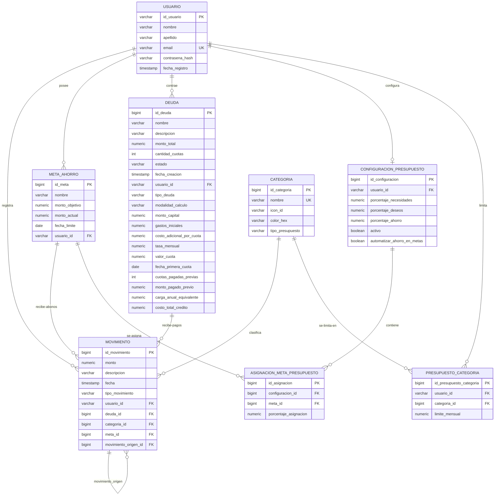
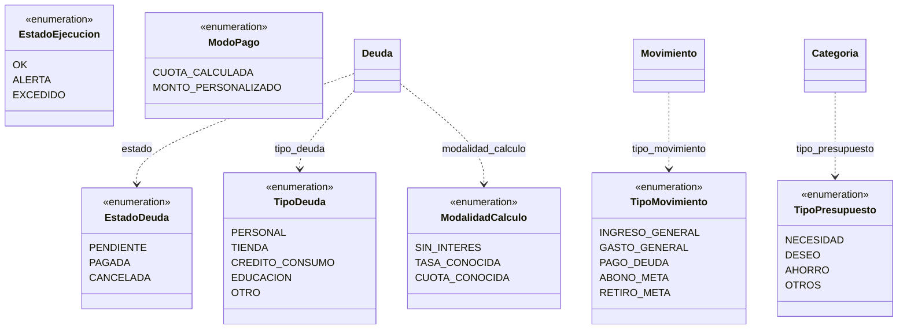

# 05 — Modelo entidad-relación (esquema físico)

**Tipo mermaid:** `erDiagram` (+ `classDiagram` para los enums) · **Estado:** completo (verificado contra el código en HEAD `446a9f5`)

## Qué responde
Las 8 tablas del esquema, sus claves, foreign keys y cardinalidades, y los enums que las alimentan.

## Fuentes
- `src/main/resources/db/migration/postgresql/V1__init_schema.sql` … `V8__normalizar_constraints_indices_rls.sql`
- `src/main/java/com/example/saveup/model/**` y `model/enums/**`
- `docs/CONTEXT.md` (§Esquema y §Entidades)

## Diagrama — tablas

## Diagrama — enums persistidos como String

## Notas y "por confirmar"
- **8 tablas** confirmadas: `usuario`, `categoria`, `meta_ahorro`, `deuda`, `movimiento`, `configuracion_presupuesto`, `asignacion_meta_presupuesto` y `presupuesto_categoria` (esta última añadida por V6). La relación `MOVIMIENTO ||--o{ MOVIMIENTO` es la **autoreferencia** `movimiento_origen_id` de V5 (vínculo de Smart-Split).
- `EstadoEjecucion` (V6, enums de T5) y `ModoPago` **no se persisten como columnas**: `EstadoEjecucion` se deriva del porcentaje usado y `ModoPago` solo decide el monto del pago. Se incluyen para completar el mapa de enums.
- `USUARIO ||--o| CONFIGURACION_PRESUPUESTO` es 1:1 (`UNIQUE(usuario_id)`). `PRESUPUESTO_CATEGORIA` tiene `UNIQUE(usuario_id, categoria_id)` y `CHECK(limite_mensual > 0)`.
- Restricción de integridad: `chk_movimiento_signo` (creado en V4) exige signo positivo para `INGRESO_GENERAL`/`RETIRO_META` y negativo para `GASTO_GENERAL`/`PAGO_DEUDA`/`ABONO_META`. V4 lo creó `NOT VALID` (el histórico puede violarlo) y **V8 lo valida** con `VALIDATE CONSTRAINT`.
- Los nombres de constraint de V3–V6 se **renombran con comillas** a mayúsculas en V7 (PostgreSQL pliega a minúsculas los identificadores sin comillas). **V8 los devuelve a minúscula**, agrega 6 índices de FK/filtro (`idx_movimiento_usuario_fecha`, `idx_deuda_usuario`, `idx_meta_usuario`, …) y activa **RLS** en las 8 tablas de dominio (el backend conecta con el rol `postgres`, que lo ignora).
