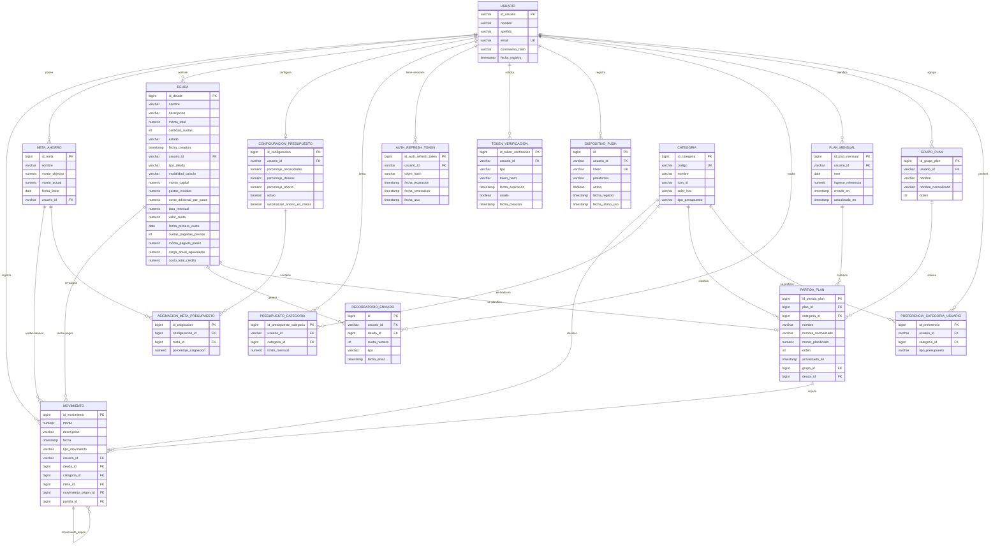
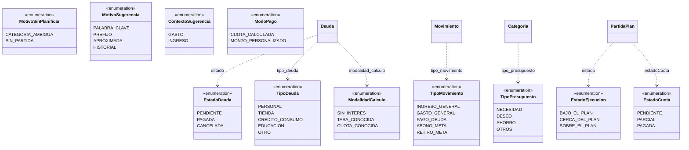

# 05 — Modelo entidad-relación (esquema físico)

**Tipo mermaid:** `erDiagram` (+ `classDiagram` para los enums) · **Estado:** completo (verificado contra el código y las migraciones V1–V17)

## Qué responde
Las 16 tablas del esquema, sus claves, foreign keys y cardinalidades, y los enums que las alimentan.

## Fuentes
- `src/main/resources/db/migration/postgresql/V1__init_schema.sql` … `V17__ajustes_t10.sql`
- `src/main/java/com/example/saveup/model/**` y `model/enums/**`
- `docs/CONTEXT.md` (§Entidades y §Esquema)

## Diagrama — tablas

## Diagrama — enums persistidos como String

## Notas
- **16 tablas** confirmadas: las 8 originales (`usuario`, `categoria`, `meta_ahorro`, `deuda`, `movimiento`, `configuracion_presupuesto`, `asignacion_meta_presupuesto`, `presupuesto_categoria`) más `auth_refresh_token` (V9), `token_verificacion` (V11), `dispositivo_push` y `recordatorio_enviado` (V12), `plan_mensual` y `partida_plan` (V14), `preferencia_categoria_usuario` (V15) y `grupo_plan` (V16). La relación `MOVIMIENTO ||--o{ MOVIMIENTO` es la **autoreferencia** `movimiento_origen_id` de V5 (vínculo de Smart-Split).
- `EstadoEjecucion`, `EstadoCuota`, `MotivoSinPlanificar`, `MotivoSugerencia`, `ContextoSugerencia` y `ModoPago` **no se persisten como columnas**; se derivan o se usan solo en la capa de servicio/DTO. Se incluyen para completar el mapa de enums.
- `USUARIO ||--o| CONFIGURACION_PRESUPUESTO` es 1:1 (`UNIQUE(usuario_id)`). `PRESUPUESTO_CATEGORIA` tiene `UNIQUE(usuario_id, categoria_id)` y `CHECK(limite_mensual > 0)`.
- `PLAN_MENSUAL` tiene `UNIQUE(usuario_id, mes)` y `CHECK(EXTRACT(DAY FROM mes) = 1)`. `PARTIDA_PLAN` tiene `UNIQUE(plan_id, nombre_normalizado)`, `CHECK(monto_planificado >= 0)`, `grupo_id` y `deuda_id` con `ON DELETE SET NULL`, e índice único parcial `uq_partida_plan_deuda (plan_id, deuda_id) WHERE deuda_id IS NOT NULL`.
- `GRUPO_PLAN` tiene `UNIQUE(usuario_id, nombre_normalizado)` y `chk_grupo_orden (orden >= 0)` (V17). `CATEGORIA.codigo` es `UNIQUE` y `chk_categoria_codigo` valida `^[A-Z][A-Z0-9_]*$` (V13, recreado con `NOT VALID` + `VALIDATE` en V17).
- Restricción de integridad: `chk_movimiento_signo` (creado en V4) exige signo positivo para `INGRESO_GENERAL`/`RETIRO_META` y negativo para `GASTO_GENERAL`/`PAGO_DEUDA`/`ABONO_META`. V4 lo creó `NOT VALID` y **V8 lo valida** con `VALIDATE CONSTRAINT`.
- Los nombres de constraint de V3–V6 se **renombran con comillas** a mayúsculas en V7 (PostgreSQL pliega a minúsculas los identificadores sin comillas). **V8 los devuelve a minúscula**, agrega 6 índices de FK/filtro y activa **RLS** en las 8 tablas de dominio originales; V9–V16 activan RLS en las tablas nuevas (el backend conecta con el rol `postgres`, que lo ignora).
