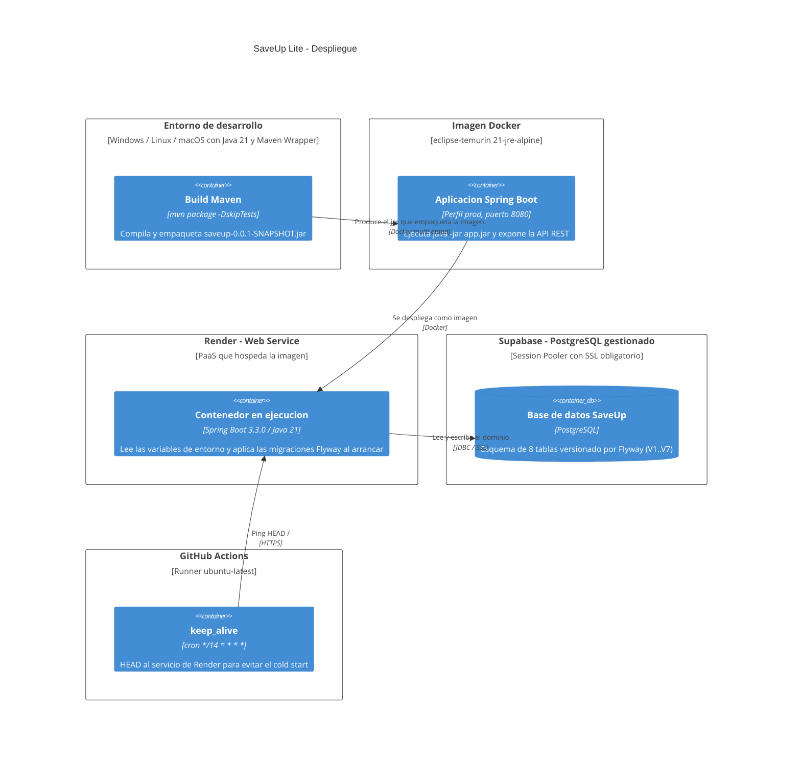

# 06 — Diagrama de despliegue

**Tipo mermaid:** `C4Deployment` · **Estado:** completo (verificado contra el código en HEAD `9e9385e`)

## Qué responde
Dónde corre la aplicación: construcción con Maven, imagen Docker, servicio en Render y base de datos Supabase, sin exponer valores de credenciales.

## Fuentes
- `Dockerfile` (multi-etapa `maven:3.9.6-eclipse-temurin-21` → `eclipse-temurin:21-jre-alpine`)
- `src/main/resources/application.properties`, `application-dev.properties`, `application-prod.properties`
- `.github/workflows/keep_alive.yml`
- `.agents/rules/00-contexto-proyecto.md`

## Diagrama

## Variables de entorno (solo nombres, sin valores)
La aplicación lee sus secretos del entorno; **no** se escriben valores en el repositorio ni en este documento.

- `SPRING_DATASOURCE_URL`
- `SPRING_DATASOURCE_USERNAME`
- `SPRING_DATASOURCE_PASSWORD`
- `JWT_SECRET`
- `SPRING_PROFILES_ACTIVE` (opcional; `application.properties` fija `prod` por defecto)

## Notas y "por confirmar"
- **Un solo entorno de base de datos**: dev y prod usan PostgreSQL/Supabase (`spring.flyway.locations=classpath:db/migration/postgresql`) y en ambos `ddl-auto` es `validate` (dev) o `none` (prod): Hibernate no crea el esquema, lo hace Flyway.
- El `Dockerfile` **no** define variables de entorno ni secretos: se inyectan en Render.
- El JWT expira a las 24 h por defecto (`jwt.expirationInMs=86400000`).
- El keep-alive existe porque Render suspende el servicio tras 15 min; el workflow pingeaa cada 14 min.
