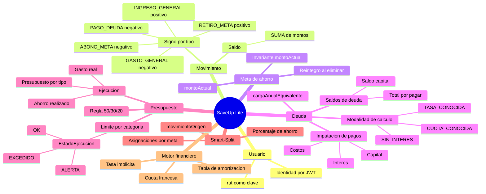

# 07 — Modelo conceptual del dominio

**Tipo mermaid:** `mindmap` · **Estado:** completo (verificado contra el código en HEAD `9e9385e`)

## Qué responde
Los conceptos del dominio y cómo se relacionan: saldo, presupuesto 50/30/20, ejecución, imputación de pagos, Smart-Split, carga anual equivalente y el signo del movimiento. Alineado con `docs/GLOSSARY.md`.

## Fuentes
- `docs/GLOSSARY.md`
- `docs/CONTEXT.md` (§Entidades, §Reglas vigentes, §Visión del módulo de deudas)
- `src/main/java/com/example/saveup/service/movimiento/SignoMovimiento.java`
- `src/main/java/com/example/saveup/service/finanzas/**`

## Diagrama

## Notas y "por confirmar"
- **Saldo** = `SUM(MOVIMIENTO.monto)`. El signo lo impone el tipo con `SignoMovimiento.aplicar(tipo, monto)`, nunca el cliente: es la única clase que llama a `.negate()`.
- **cargaAnualEquivalente**: en el código el indicador financiero se llama siempre `cargaAnualEquivalente`; "CAE" es ambiguo en `GLOSSARY.md` porque también designa el Crédito con Aval del Estado, que en SaveUp es solo un `TipoDeuda.EDUCACION`.
- **Invariante de metas**: tras abonar, retirar, Smart-Split y eliminar, `montoActual` = −(suma de movimientos `ABONO_META` vinculados a esa meta).
- **Ejecución presupuestaria**: presupuesto = ingresos del mes × porcentaje; gasto real = `GASTO_GENERAL` y `PAGO_DEUDA` clasificados por `categoria.tipoPresupuesto`; `ahorroRealizado` = suma de `ABONO_META` del mes.
- **EstadoEjecucion** se deriva del porcentaje usado con umbrales `80` y `100` (`UMBRAL_ALERTA` / `UMBRAL_EXCEDIDO`).
