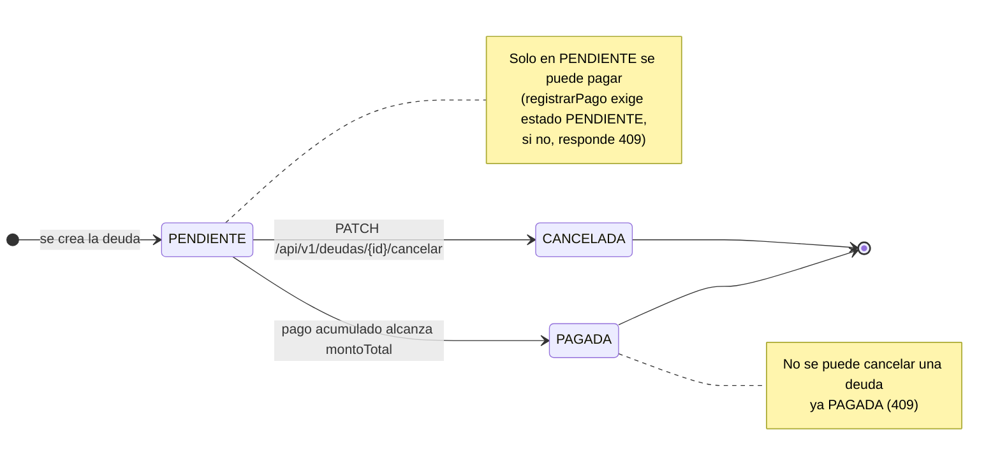
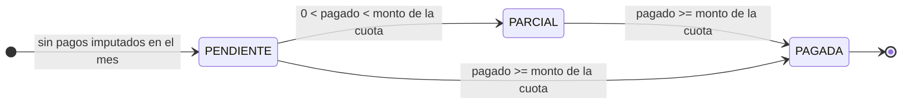

# 08 — Diagramas de estado

**Tipo mermaid:** `stateDiagram-v2` · **Estado:** completo (verificado contra el código y las migraciones V1–V17)

## Qué responde
Ciclo de vida de una deuda (`EstadoDeuda`), estado del pago de una cuota (`EstadoCuota`) y derivación del estado de ejecución de un límite o partida (`EstadoEjecucion`).

## Fuentes
- `src/main/java/com/example/saveup/model/enums/EstadoDeuda.java`
- `src/main/java/com/example/saveup/model/enums/EstadoEjecucion.java`
- `src/main/java/com/example/saveup/model/enums/EstadoCuota.java`
- `src/main/java/com/example/saveup/service/DeudaService.java` (`registrarPago`, `cancelarDeuda`)
- `src/main/java/com/example/saveup/service/PresupuestoService.java`
- `src/main/java/com/example/saveup/service/plan/CalculadoraPlan.java`

## Diagrama — EstadoDeuda

## Diagrama — EstadoEjecucion (T5/T10a)

```mermaid
stateDiagram-v2
    direction LR
    [*] --> BAJO_EL_PLAN : sin plan o real menor al 80 %
    BAJO_EL_PLAN --> CERCA_DEL_PLAN : real x 100 >= 80 x planificado
    CERCA_DEL_PLAN --> SOBRE_EL_PLAN : real x 100 > 100 x planificado
    SOBRE_EL_PLAN --> CERCA_DEL_PLAN : real x 100 <= 100 x planificado
    CERCA_DEL_PLAN --> BAJO_EL_PLAN : real x 100 < 80 x planificado
    SOBRE_EL_PLAN --> BAJO_EL_PLAN : real x 100 < 80 x planificado

    note right of BAJO_EL_PLAN
        EstadoEjecucion.desde(real, planificado)
        UMBRAL_CERCA = 80
        UMBRAL_SOBRE = 100
        porcentaje exacto, sin redondear (multiplicacion cruzada)
        planificado 0: SOBRE si real > 0; BAJO si real = 0
    end note
```

## Diagrama — EstadoCuota (T10d)

## Notas
- `EstadoDeuda` tiene 3 valores: `PENDIENTE`, `PAGADA`, `CANCELADA`. La BD lo refuerza con `chk_deuda_estado` (V1) y al persistir se aplica `PENDIENTE` por defecto (`Deuda.@PrePersist`).
- El paso `PENDIENTE → PAGADA` ocurre cuando `montoPagadoPrevio + pagos reales + este pago >= montoTotal`; además los DTO derivan `PAGADA` si `totalPorPagar` llega a 0.
- `EstadoEjecucion` es **derivado, no persistido**: se calcula con `EstadoEjecucion.desde(real, planificado)` comparando `real × 100` contra `80 × planificado` y `100 × planificado`, sin dividir ni redondear. `80 %` y `100 %` exactos son `CERCA_DEL_PLAN`; solo `> 100 %` es `SOBRE_EL_PLAN`. Un planificado 0 se trata sin división: `SOBRE_EL_PLAN` si hubo gasto, `BAJO_EL_PLAN` si no.
- `EstadoCuota` es informativo y se calcula solo para partidas vinculadas a una deuda (T10d); no sustituye al `estado` neutro.
- `EstadoEjecucion` y `EstadoCuota` no se persisten; el `estado` de la deuda sí es una columna `deuda.estado`.
