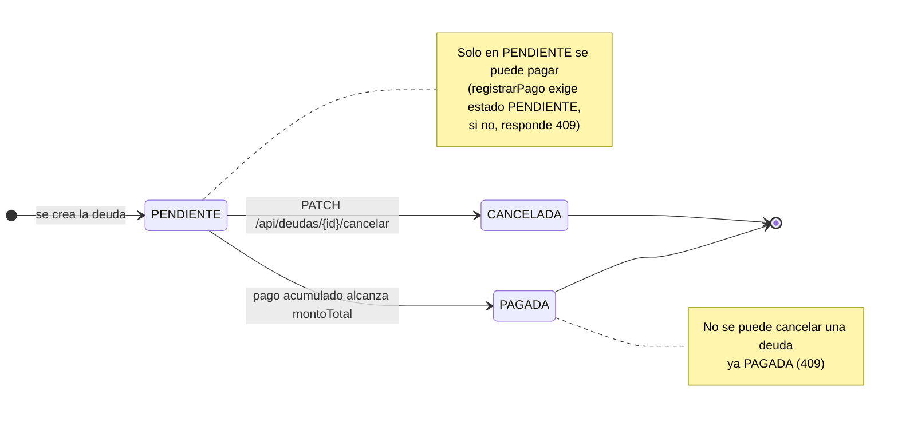
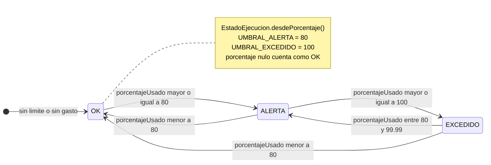

# 08 — Diagramas de estado

**Tipo mermaid:** `stateDiagram-v2` · **Estado:** completo (verificado contra el código en HEAD `9e9385e`)

## Qué responde
Ciclo de vida de una deuda (`EstadoDeuda`) y derivación del estado de ejecución de un límite presupuestario (`EstadoEjecucion`).

## Fuentes
- `src/main/java/com/example/saveup/model/enums/EstadoDeuda.java`
- `src/main/java/com/example/saveup/model/enums/EstadoEjecucion.java`
- `src/main/java/com/example/saveup/service/DeudaService.java` (`registrarPago`, `cancelarDeuda`)
- `src/main/java/com/example/saveup/service/PresupuestoService.java`

## Diagrama — EstadoDeuda

## Diagrama — EstadoEjecucion

## Notas y "por confirmar"
- `EstadoDeuda` tiene 3 valores: `PENDIENTE`, `PAGADA`, `CANCELADA`. La BD lo refuerza con `CHK_DEUDA_ESTADO` (V1) y al persistir se aplica `PENDIENTE` por defecto (`Deuda.@PrePersist`).
- El paso `PENDIENTE → PAGADA` ocurre cuando `montoPagadoPrevio + pagos reales + este pago >= montoTotal`; además los DTO derivan `PAGADA` si `totalPorPagar` llega a 0.
- `EstadoEjecucion` es **derivado, no persistido**: se calcula con `compareTo` (no `equals`), por lo que `80` y `80.00` se comportan igual.
