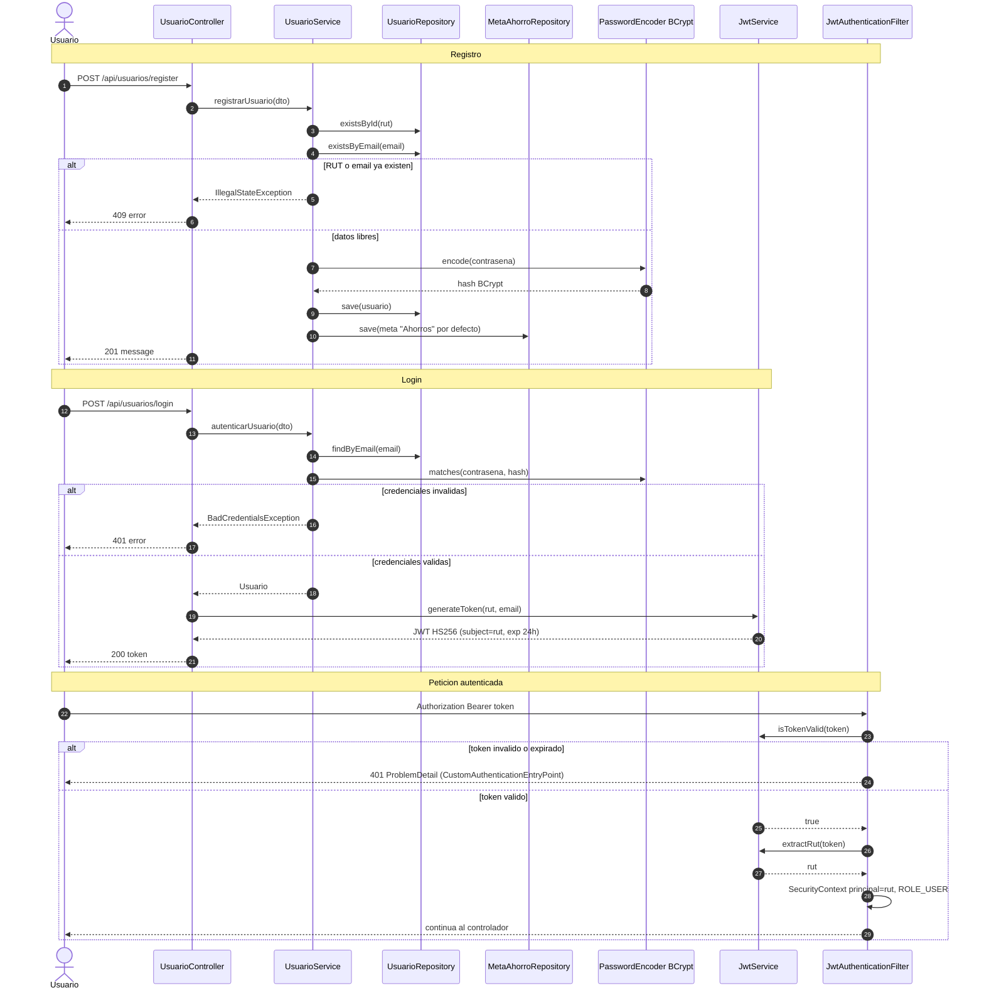

# 09 — Flujo: autenticación y JWT

**Tipo mermaid:** `sequenceDiagram` · **Estado:** completo (verificado contra el código en HEAD `9e9385e`)

## Qué responde
Cómo se registra y autentica un usuario, cómo se emite el JWT en el login y cómo se valida en cada petición posterior.

## Fuentes
- `src/main/java/com/example/saveup/controller/UsuarioController.java`
- `src/main/java/com/example/saveup/service/UsuarioService.java`
- `src/main/java/com/example/saveup/security/JwtService.java`, `JwtAuthenticationFilter.java`, `SecurityUtils.java`
- `src/main/java/com/example/saveup/config/SecurityConfig.java`

## Diagrama

## Notas y "por confirmar"
- El token es **HS256**; el `subject` es el RUT y lleva el `email` como claim. La clave se toma de `jwt.secret` y se rellena a 32 bytes si es más corta.
- `register` y `login` son los únicos endpoints públicos junto con `OPTIONS /**` y `GET/HEAD /`.
- La identidad de cada recurso se resuelve siempre con `SecurityUtils.getAuthenticatedRut()`; nunca se acepta el RUT desde el cuerpo.
- `POST /api/movimientos` con tipo `PAGO_DEUDA` no aplica aquí: se resuelve en el flujo de pago de deuda ([`11-flujo-pago-deuda.md`](11-flujo-pago-deuda.md)).
