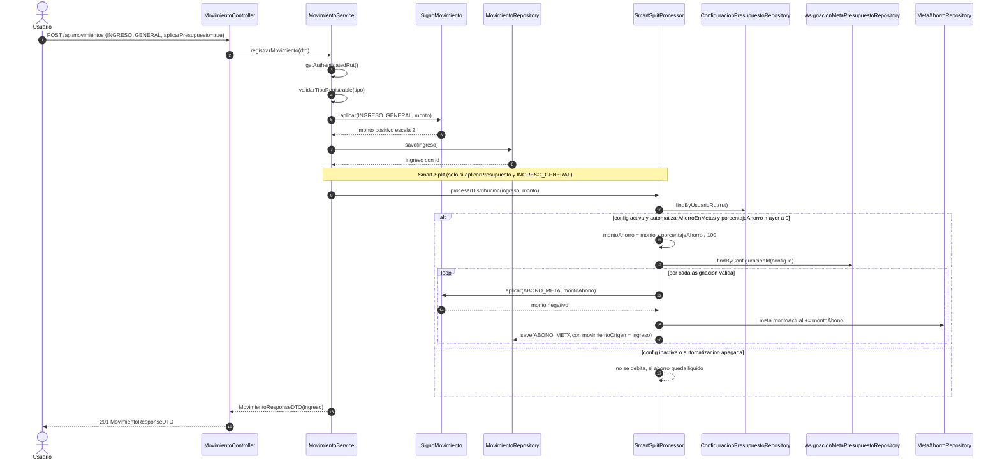

# 10 — Flujo: movimiento con Smart-Split

**Tipo mermaid:** `sequenceDiagram` · **Estado:** completo (verificado contra el código en HEAD `9e9385e`)

## Qué responde
Cómo se registra un movimiento, cómo se fija su signo por tipo y cómo un `INGRESO_GENERAL` con Smart-Split genera `ABONO_META` por cada meta asignada.

## Fuentes
- `src/main/java/com/example/saveup/controller/MovimientoController.java`
- `src/main/java/com/example/saveup/service/MovimientoService.java`
- `src/main/java/com/example/saveup/service/SmartSplitProcessor.java`
- `src/main/java/com/example/saveup/service/movimiento/SignoMovimiento.java`
- `docs/CONTEXT.md` (regla Smart-Split y signo)

## Diagrama

## Notas y "por confirmar"
- El **signo no lo decide el cliente**: `SignoMovimiento.aplicar(tipo, monto)` devuelve el valor absoluto con escala 2 y lo niega para `GASTO_GENERAL`, `PAGO_DEUDA` y `ABONO_META`. Monto 0 o nulo produce `IllegalArgumentException` (400).
- El ingreso se guarda **antes** de repartir, para dejar en cada abono el vínculo `movimiento_origen_id` (T4). Un ingreso con movimientos derivados no se puede editar ni borrar (409).
- La última asignación recibe el **residuo de redondeo** para que la suma de abonos sea exactamente `montoAhorro`.
- **Invariante de metas**: `montoActual` = −(suma de `ABONO_META` vinculados a la meta).
- `POST /api/movimientos` solo acepta `INGRESO_GENERAL`, `GASTO_GENERAL` y `PAGO_DEUDA`; `ABONO_META`/`RETIRO_META` se rechazan con 400 en este endpoint.
- Si el tipo es `PAGO_DEUDA`, `MovimientoService` delega en `DeudaService.registrarPago` (ver [`11-flujo-pago-deuda.md`](11-flujo-pago-deuda.md)).
