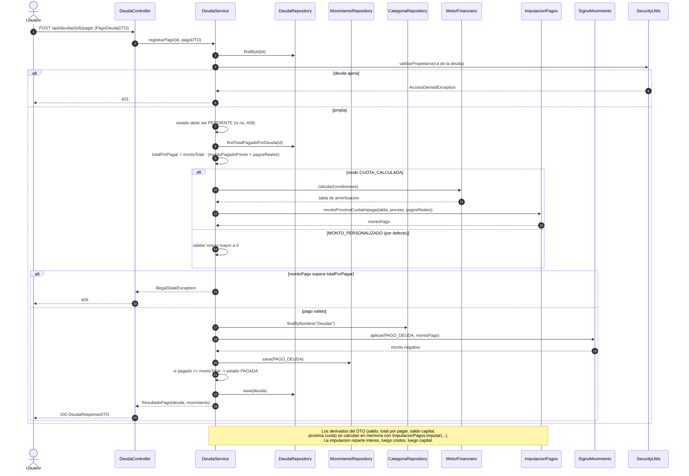

# 11 — Flujo: pago de deuda

**Tipo mermaid:** `sequenceDiagram` · **Estado:** completo (verificado contra el código en HEAD `446a9f5`)

## Qué responde
Cómo se registra un pago contra una deuda, cómo se determina el monto, cómo se crea el movimiento `PAGO_DEUDA` y cómo se recalculan los saldos por imputación.

## Fuentes
- `src/main/java/com/example/saveup/controller/DeudaController.java`
- `src/main/java/com/example/saveup/service/DeudaService.java`
- `src/main/java/com/example/saveup/service/finanzas/ImputacionPagos.java`
- `src/main/java/com/example/saveup/service/movimiento/SignoMovimiento.java`
- `.agents/rules/40-calculo-financiero.md`

## Diagrama

## Notas y "por confirmar"
- `DeudaService.registrarPago` es el **único productor** de `PAGO_DEUDA`: tanto `POST /api/deudas/{id}/pagar` como `POST /api/movimientos` con ese tipo terminan aquí.
- `modoPago`: `CUOTA_CALCULADA` cobra lo que falta de la próxima cuota impaga (cuota + costo adicional); `MONTO_PERSONALIZADO` (por defecto) exige `monto > 0`.
- Sobrepago, deuda no `PENDIENTE` o `cuotasPagadasPrevias >= cantidadCuotas` → **409**; deuda ajena → **403**; validación → **400**.
- `saldoCapital` aproxima lo que costaría liquidar hoy y **no** incluye el interés devengado del mes en curso. `totalPorPagar` incluye intereses futuros.
- Nada de la imputación se persiste: se recalcula desde el cronograma, `cuotasPagadasPrevias` y la suma de pagos reales.
