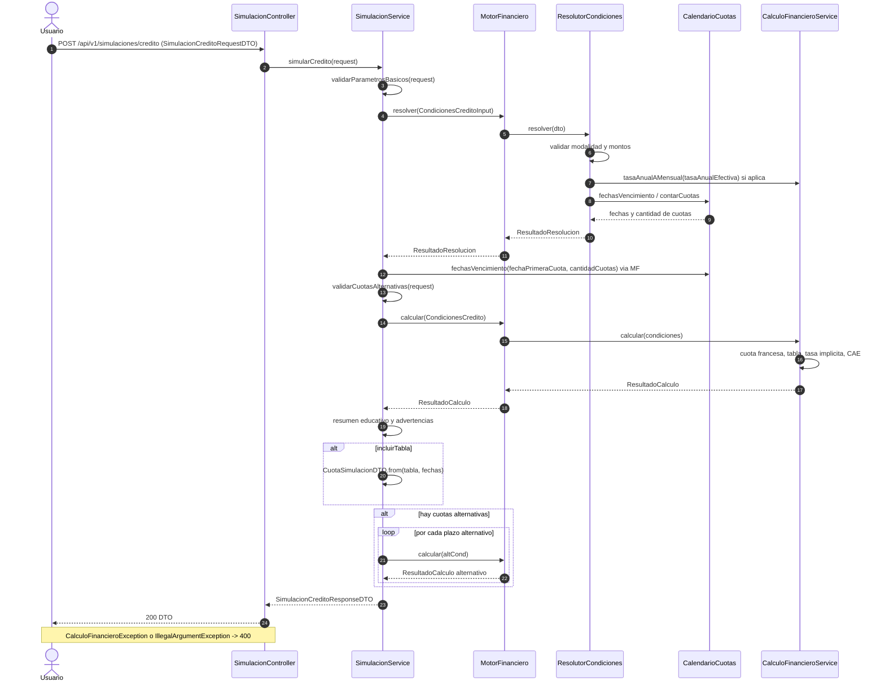

# 12 — Flujo: simulación de crédito

**Tipo mermaid:** `sequenceDiagram` · **Estado:** completo (verificado contra el código en HEAD `446a9f5`)

## Qué responde
Cómo se procesa `POST /api/v1/simulaciones/credito`: resolución de condiciones, cálculo en el motor financiero puro y armado del DTO de respuesta, sin persistir nada.

## Fuentes
- `src/main/java/com/example/saveup/controller/SimulacionController.java`
- `src/main/java/com/example/saveup/service/SimulacionService.java`
- `src/main/java/com/example/saveup/service/finanzas/ResolutorCondiciones.java`, `MotorFinanciero.java`, `CalculoFinancieroService.java`, `CalendarioCuotas.java`
- `src/main/java/com/example/saveup/dto/PorcentajeTasa.java`

## Diagrama

## Notas y "por confirmar"
- El flujo **no toca la base de datos**: `SimulacionService` no inyecta repositorios.
- Dentro del motor, las tasas son **fracciones** (`0.015` = 1,5 %); la conversión a porcentaje vive en `PorcentajeTasa`, en la capa DTO.
- Reglas de modalidad: `SIN_INTERES` no admite tasa ni cuota; `TASA_CONOCIDA` exige exactamente una tasa; `CUOTA_CONOCIDA` exige `valorCuota > 0` y no admite tasas ni cuotas alternativas.
- Se emiten advertencias: la del `cargaAnualEquivalente` referencial y, si la cuota supera el 30 % del ingreso declarado, la de sobreendeudamiento.
- Las condiciones normalizadas exponen las tasas en porcentaje (`tasaMensual`, `tasaAnualEfectiva`).
