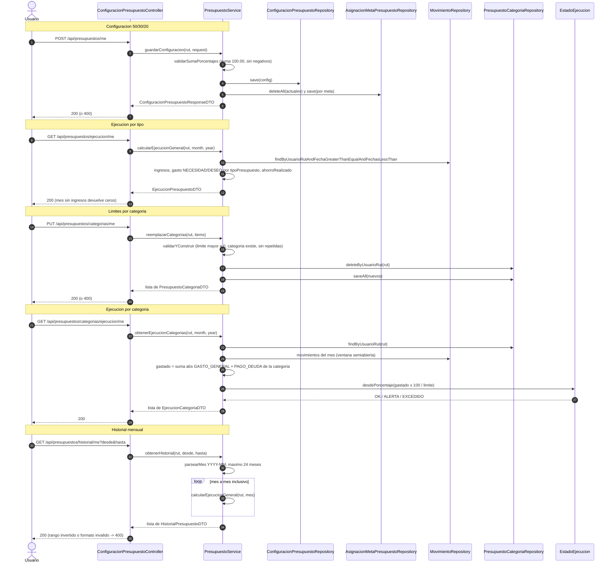

# 13 — Flujo: presupuesto 50/30/20 y ejecución

**Tipo mermaid:** `sequenceDiagram` · **Estado:** completo (verificado contra el código en HEAD `9e9385e`)

## Qué responde
Cómo se guarda la configuración 50/30/20, cómo se calcula la ejecución por tipo y por categoría y cómo se arma el historial mensual.

## Fuentes
- `src/main/java/com/example/saveup/controller/ConfiguracionPresupuestoController.java`
- `src/main/java/com/example/saveup/service/PresupuestoService.java`
- `src/main/java/com/example/saveup/service/movimiento/FechasMovimiento.java`
- `src/main/java/com/example/saveup/model/enums/EstadoEjecucion.java`
- `.agents/rules/40-calculo-financiero.md`

## Diagrama

## Notas y "por confirmar"
- Toda identidad llega como RUT del token; `PresupuestoService` nunca lee el usuario del cuerpo.
- La ventana de un mes es **semiabierta** `[inicioDeMes, inicioDeMesSiguiente)` y la resuelve `FechasMovimiento`, única clase que convierte `YearMonth`/`LocalDate` a `java.util.Date`.
- **Ejecución general**: `presupuesto = ingresos del mes × porcentaje`; gasto real = `GASTO_GENERAL` + `PAGO_DEUDA` clasificados por `categoria.tipoPresupuesto`; `ahorroRealizado` = suma de `ABONO_META`.
- **Ejecución por categoría**: `gastado` cuenta `GASTO_GENERAL` y `PAGO_DEUDA` de esa categoría en el mes; `estado = EstadoEjecucion.desdePorcentaje(porcentajeUsado)` con umbrales 80/100.
- El historial reutiliza `calcularEjecucionGeneral` mes a mes (no duplica el cálculo) y accede a la BD con **una consulta por mes**.
