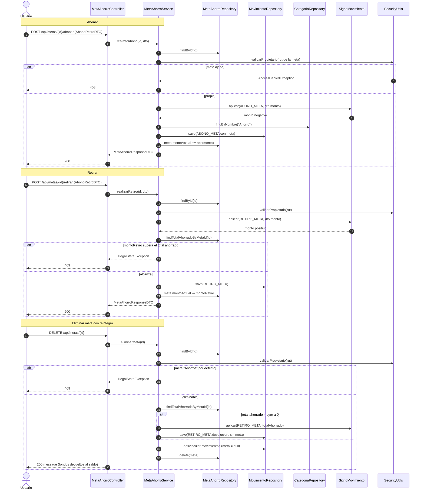

# 14 — Flujo: abono, retiro y eliminación de meta

**Tipo mermaid:** `sequenceDiagram` · **Estado:** completo (verificado contra el código en HEAD `446a9f5`)

## Qué responde
Cómo se abona y retira de una meta de ahorro, cómo se ajusta `montoActual` y cómo se reintegran los fondos al eliminar una meta.

## Fuentes
- `src/main/java/com/example/saveup/controller/MetaAhorroController.java`
- `src/main/java/com/example/saveup/service/MetaAhorroService.java`
- `src/main/java/com/example/saveup/service/movimiento/SignoMovimiento.java`
- `src/main/java/com/example/saveup/repository/MetaAhorroRepository.java`
- `docs/CONTEXT.md` (invariante de metas)

## Diagrama

## Notas y "por confirmar"
- Los movimientos de meta (`ABONO_META`, `RETIRO_META`) **solo** se crean desde `/api/metas`; `POST /api/movimientos` los rechaza con 400 para que siempre exista la meta que los respalda.
- El signo lo impone `SignoMovimiento`: `ABONO_META` negativo (el dinero sale del saldo principal), `RETIRO_META` positivo (vuelve al saldo).
- El control de retiro se hace sobre el **valor canónico absoluto**, no sobre lo que envía el cliente.
- Al eliminar con ahorro acumulado se crea un `RETIRO_META` **sin vincular** a la meta, y luego se desvinculan los movimientos existentes antes de borrarla.
- La meta por defecto `Ahorros` no se puede eliminar y, en edición, solo permite cambiar el nombre.
- **Invariante**: `montoActual` = −(suma de `ABONO_META` vinculados a la meta).
