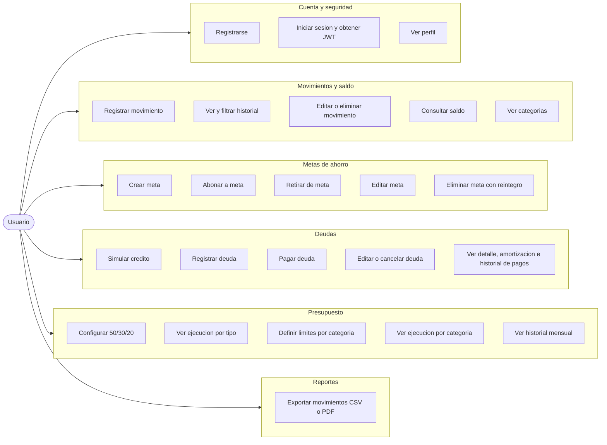

# 15 — Mapa de casos de uso por módulo

**Tipo mermaid:** `flowchart` (mermaid no tiene diagrama UML de casos de uso) · **Estado:** completo (verificado contra el código en HEAD `446a9f5`)

## Qué responde
Los casos de uso cubiertos por el backend, agrupados por módulo y ligados al actor Usuario.

## Fuentes
- `docs/CONTEXT.md` (§Endpoints)
- `src/main/java/com/example/saveup/controller/**`
- `docs/tareas/T0..T5`, `T1d` y `BACKLOG.md`

## Diagrama

## Detalle por caso de uso (trazabilidad)

| Caso de uso | Endpoint(s) | Tarea |
|---|---|---|
| Registrarse | `POST /api/v1/usuarios/register` | base |
| Iniciar sesión | `POST /api/v1/usuarios/login` | base |
| Ver perfil | `GET /api/v1/usuarios/me` | base |
| Registrar movimiento | `POST /api/v1/movimientos` | base, T1d |
| Ver y filtrar historial | `GET /api/v1/movimientos/me`, `GET /api/v1/movimientos/paginados/me` | T4 |
| Editar o eliminar movimiento | `PUT/DELETE /api/v1/movimientos/{id}` | T4 |
| Consultar saldo | `GET /api/v1/saldos/me` | base |
| Ver categorías | `GET /api/v1/categorias` | base |
| Crear meta | `POST /api/v1/metas` | base |
| Abonar a meta | `POST /api/v1/metas/{id}/abonar` | T1d |
| Retirar de meta | `POST /api/v1/metas/{id}/retirar` | T1d |
| Editar meta | `PUT /api/v1/metas/{id}` | base |
| Eliminar meta con reintegro | `DELETE /api/v1/metas/{id}` | T1d |
| Simular crédito | `POST /api/v1/simulaciones/credito` | T1a, T1b |
| Registrar deuda | `POST /api/v1/deudas` | T1c |
| Pagar deuda | `POST /api/v1/deudas/{id}/pagar` | T2 |
| Editar o cancelar deuda | `PUT /api/v1/deudas/{id}`, `PATCH /api/v1/deudas/{id}/cancelar` | T1c, T2 |
| Ver detalle, amortización e historial | `GET /api/v1/deudas/{id}`, `.../amortizacion`, `.../pagos` | T3 |
| Configurar 50/30/20 | `GET/POST /api/v1/presupuestos/me` | base |
| Ver ejecución por tipo | `GET /api/v1/presupuestos/ejecucion/me` | base |
| Definir límites por categoría | `GET/PUT /api/v1/presupuestos/categorias/me` | T5 |
| Ver ejecución por categoría | `GET /api/v1/presupuestos/categorias/ejecucion/me` | T5 |
| Ver historial mensual | `GET /api/v1/presupuestos/historial/me` | T5 |
| Exportar movimientos | `GET /api/v1/reportes/movimientos/exportar` | base |

## Notas y "por confirmar"
- El `flowchart` conecta al actor con **cada módulo** (subgraph) para mantener la legibilidad; el detalle caso→endpoint está en la tabla.
- La **trazabilidad a historias de usuario** vive en [`../historias-de-usuario/README.md`](../historias-de-usuario/README.md) (24 / 24 casos de uso cubiertos).
- Casos no cubiertos aquí como flujo de secuencia propio: los reportes y la verificación de propiedad anti-IDOR se describen en [`03-componentes.md`](03-componentes.md) y [`09-flujo-auth.md`](09-flujo-auth.md).
