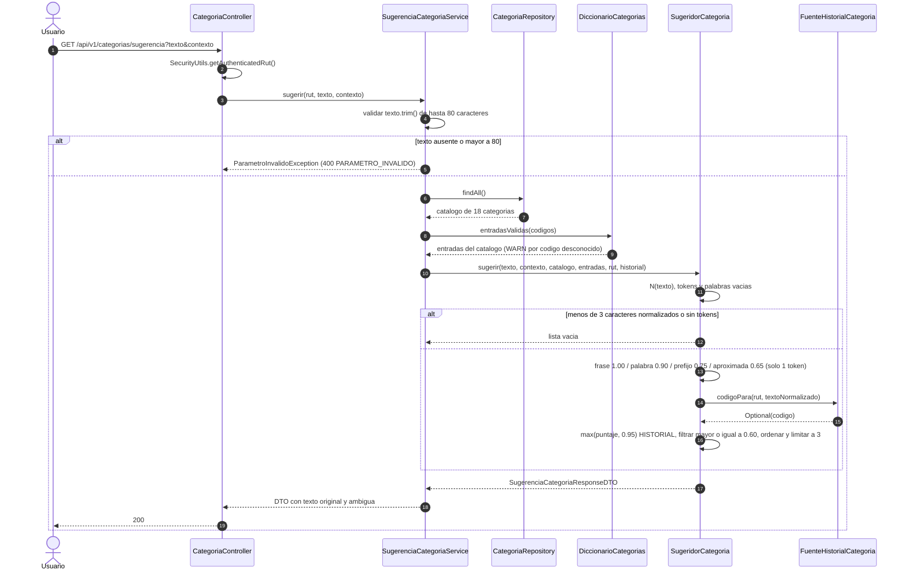

# 16 — Flujo: sugerencia de categoría por texto

**Tipo mermaid:** `sequenceDiagram` · **Estado:** completo (verificado contra el código de T10b)

## Qué responde
Cómo el backend convierte un texto libre ("supermercado", "cena aniversario") en hasta 3 categorías con confianza y
motivo, sin persistir nada ni registrar el texto del usuario.

## Fuentes
- `src/main/java/com/example/saveup/controller/CategoriaController.java`
- `src/main/java/com/example/saveup/service/categoria/SugerenciaCategoriaService.java`
- `src/main/java/com/example/saveup/service/categoria/SugeridorCategoria.java`
- `src/main/java/com/example/saveup/service/categoria/DiccionarioCategorias.java`
- `src/main/java/com/example/saveup/service/categoria/NormalizadorTexto.java`
- `src/main/java/com/example/saveup/service/categoria/DistanciaEdicion.java`
- `src/main/java/com/example/saveup/service/categoria/FuenteHistorialCategoria.java`
- `src/main/resources/categorias/diccionario.json`
- `src/test/resources/categorias/sugerencias-golden.csv`

## Diagrama

## Notas y "por confirmar"
- La identidad sale **solo** del JWT (`SecurityUtils.getAuthenticatedRut()`); el endpoint no acepta `usuarioRut`.
- `contexto` es opcional (`GASTO` por defecto). `GASTO` excluye `SUELDO` y `AHORRO`; `INGRESO` solo permite `SUELDO` y
  `OTROS`. Un valor desconocido lo rechaza Spring como `MethodArgumentTypeMismatchException` → 400 `PARAMETRO_INVALIDO`.
- El puntaje efectivo es `base × peso` con `BigDecimal` escala 2 (`HALF_UP`). La coincidencia **aproximada** solo se
  evalúa cuando el texto normalizado tiene **un único token**: una frase no se "corrige" por una letra.
- `ambigua` es verdadera si hay al menos 2 sugerencias y la diferencia entre la primera y la segunda es
  **estrictamente menor** que 0,10. Los empates se ordenan por `codigo` alfabético.
- El historial es una interfaz con implementación vacía en T10b (`FuenteHistorialCategoriaVacia`); T10c la reemplaza
  por el historial real. Cuando devuelve un código, esa categoría sube a 0,95 con motivo `HISTORIAL`.
- El diccionario se carga una vez desde `classpath:categorias/diccionario.json`; los códigos que no existen en el
  catálogo se ignoran con un WARN y no fallan el arranque.
- No hay persistencia ni log del texto (G9). La respuesta ecoa el texto original exacto para que Flutter descarte
  respuestas atrasadas cuando el usuario siguió escribiendo.
