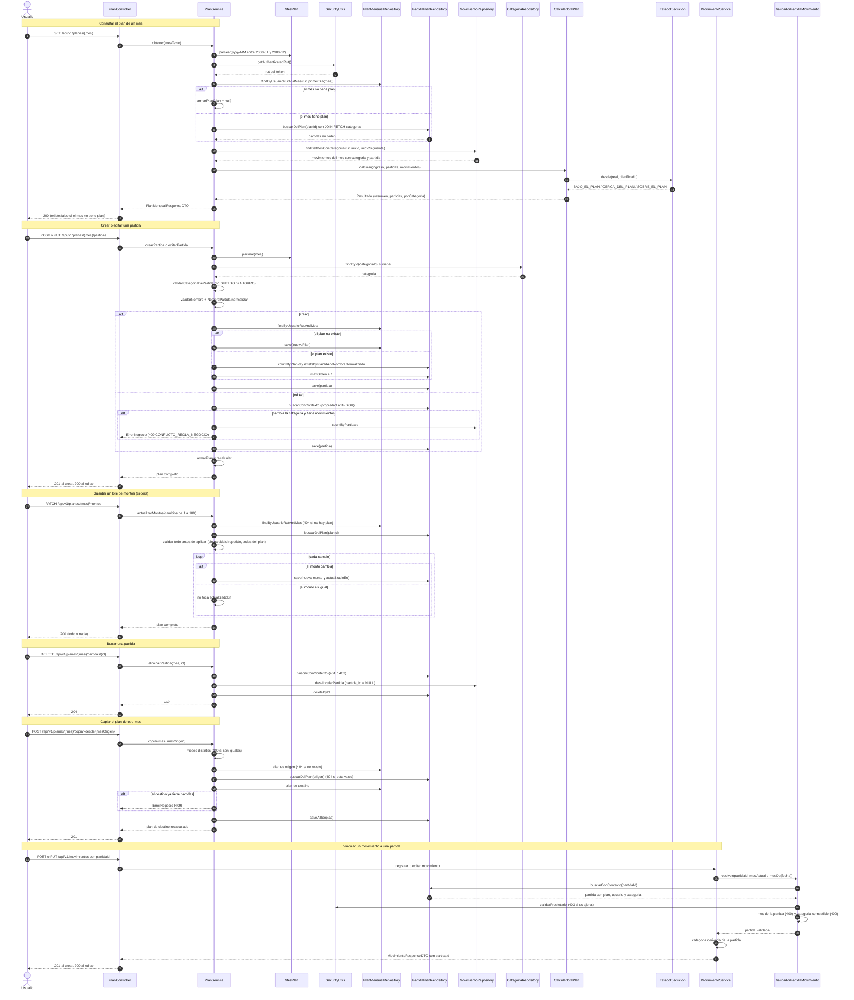

# 17 — Flujo: plan del mes y partidas

**Tipo mermaid:** `sequenceDiagram` · **Estado:** completo (verificado contra el código de T10c)

## Qué responde
Cómo se arma el plan de un mes (partidas + ingreso de referencia + gasto real), cómo se crean, editan, borran y
copian partidas, cómo se guarda un lote de montos y cómo se vincula un movimiento a una partida.

## Fuentes
- `src/main/java/com/example/saveup/controller/PlanController.java`
- `src/main/java/com/example/saveup/service/plan/PlanService.java`
- `src/main/java/com/example/saveup/service/plan/CalculadoraPlan.java`
- `src/main/java/com/example/saveup/service/plan/MesPlan.java`
- `src/main/java/com/example/saveup/service/plan/NombrePartida.java`
- `src/main/java/com/example/saveup/service/plan/ValidadorPartidaMovimiento.java`
- `src/main/java/com/example/saveup/service/movimiento/FechasMovimiento.java`
- `src/main/java/com/example/saveup/model/enums/EstadoEjecucion.java`
- `src/main/java/com/example/saveup/repository/MovimientoRepository.java`

## Diagrama

## Notas y "por confirmar"
- `mes` se escribe `yyyy-MM`; se persiste como `LocalDate` del día 1 (`MesPlan.primerDia`) y se devuelve como
  `yyyy-MM`. El rango permitido es `2000-01` a `2100-12`; fuera de él, **400** `PARAMETRO_INVALIDO`.
- La identidad sale **solo** del JWT. Una partida ajena responde **403**; una partida inexistente o de otro mes,
  **404**.
- `armarPlan` hace un número fijo de consultas (plan, partidas con categoría y movimientos del mes con categoría y
  partida). El caso C56 exige **máximo 5** con 100 partidas y 500 movimientos.
- La **imputación** se calcula al leer y no se guarda: `partidaId` manda; si falta y la categoría tiene exactamente
  una partida, va a ella; con dos o más → `CATEGORIA_AMBIGUA`; sin partidas → `SIN_PARTIDA`. Solo se imputan
  `GASTO_GENERAL` y `PAGO_DEUDA`.
- Todo el dinero lo calcula `CalculadoraPlan` (clase pura): `BigDecimal` escala 2 `HALF_UP`; `porcentajeUsado` se
  trunca (`ROUND_DOWN`) y el estado se compara por multiplicación cruzada, sin redondear. Las fórmulas y los
  vectores V01–V18 están en [`../PLAN_FORMULAS.md`](../PLAN_FORMULAS.md) y [`../plan-vectores.json`](../plan-vectores.json).
- El nombre de la partida nunca se registra en logs (G9). `NombrePartida.normalizar` (minúsculas, sin tildes,
  espacios colapsados) es la clave de unicidad y la que consulta el historial del sugeridor (T10b).
- Borrar una partida no borra movimientos: `MovimientoRepository.desvincularPartida` los deja con
  `partida_id = NULL` y, al releer el plan, se reimputan por categoría.
- El plan es independiente del presupuesto 50/30/20 (diagrama 13): comparten movimientos y `EstadoEjecucion`, pero
  el plan reparte por partida y el presupuesto por tipo.
