# Handoff Report: Diagnóstico y Estrategia de Resolución para Java(4195411) — 'Flexible Constructor Bodies'

**Para:** Agente sucesor / Equipo de Ingeniería  
**De:** Antigravity Pairing Agent  
**Contexto del Repositorio:** `ItsMilkey/LITE` (Spring Boot 3.3.0, Java 21 LTS)  
**Fecha:** 15 de octubre de 2026  
**Severidad:** Alta en Developer Experience (IDE bloqueado con falsos positivos / red squiggles en múltiples archivos); Nula en Maven CI/CD (compilación `javac` en verde).

---

## 1. Resumen Ejecutivo

Al abrir clases que utilizan anotaciones generadoras de constructores de Lombok (`@RequiredArgsConstructor`, `@AllArgsConstructor`, `@NoArgsConstructor`), el servidor de lenguaje de Java en VS Code (*Language Support for Java by Red Hat*, basado en Eclipse JDT Core / ECJ) marca el error:

```text
The Java feature 'Flexible Constructor Bodies' is only available with source level 25 and above Java(4195411)
```

El error no ocurre por un error sintáctico del desarrollador, sino por un desajuste de representación de AST entre el generador de código de Lombok (versión `1.18.46`) y las validaciones introducidas en versiones recientes del compilador de Eclipse (ECJ) para soportar **JEP 513 (Flexible Constructor Bodies)** en entornos donde el JDK anfitrión es Java 26 pero el proyecto está fijado en Java 21.

---

## 2. Diagnóstico Técnico Profundo (Root Cause Analysis)

### 2.1. ¿Qué es 'Flexible Constructor Bodies'?
Formalizado en **Java 25** a través del [JEP 513](https://openjdk.org/jeps/513) (sucesor de los previews JEP 447, JEP 482 y JEP 492 en Java 22, 23 y 24), este feature relaja la restricción histórica que obligaba a que la primera línea de cualquier constructor fuera estrictamente `super(...)` o `this(...)`. Con JEP 513, un constructor puede ejecutar sentencias en un "prólogo" antes del llamado delegado.

### 2.2. La regla del compilador ECJ (`Java(4195411)`)
En `org.eclipse.jdt.core`, el identificador de problema `4195411` (`IProblem.FlexibleConstructorBodiesNotSupported`) es emitido cuando el compilador analiza el cuerpo de un constructor (`ConstructorDeclaration`) y encuentra sentencias de asignación o lógica previas a un `ExplicitConstructorCall`, o cuando el llamado explícito a `super()` no está presente en la posición esperada del AST, **y simultáneamente el nivel de fuente (`sourceLevel`) del proyecto es menor a Java 25**.

### 2.3. La discrepancia entre entornos de compilación

```mermaid
flowchart TD
    subgraph Maven_CLI ["Entorno 1: Consola / CI (Maven)"]
        pom["pom.xml (source=21)"] --> javac["OpenJDK javac compiler"]
        javac --> lombok_javac["Lombok Javac Handler"]
        lombok_javac --> build_ok["BUILD SUCCESS (171/171 tests OK)"]
    end

    subgraph VSCode_IDE ["Entorno 2: VS Code / Language Server"]
        jdk26["Host JDK 26 (C:\\Program Files\\Java\\jdk-26.0.1)"] --> ecj["Eclipse JDT LS (ECJ)"]
        ecj --> ecj_parser["ECJ Constructor Validator (JEP 513 rules active)"]
        ecj_parser --> lombok_ecj["Lombok Eclipse Handler (HandleConstructor)"]
        lombok_ecj --> ast_mismatch["Sintetiza this.x = x sin explicit super slot"]
        ast_mismatch --> ecj_err["Java(4195411): 'Flexible Constructor Bodies' requires source level 25+"]
    end
```



- **En consola / CI:** `./mvnw clean compile` y `./mvnw test` invocan el compilador oficial de OpenJDK (`javac`) a través de `maven-compiler-plugin`. Lombok cuenta con un handler específico para `javac` (`com.sun.tools.javac`) que genera un AST/bytecode perfectamente conforme a Java 21.
- **En VS Code:** El plugin de Red Hat no ejecuta `javac`; ejecuta **Eclipse JDT** (ECJ) embebido en un Language Server. Dicho servidor arranca sobre el JDK del sistema operativo (que en esta máquina es **JDK 26.0.1**). El validador de constructores de ECJ tiene activas las comprobaciones de Java 25/26.
- **La falla de Lombok en ECJ:** Al procesar `@RequiredArgsConstructor` o `@AllArgsConstructor`, el handler de Lombok para Eclipse (`lombok.eclipse.handlers.HandleConstructor`) inyecta directamente sentencias de asignación de campos en el array `statements` del nodo AST `ConstructorDeclaration`. El nuevo validador de ECJ no ve un `ExplicitConstructorCall` tradicional en el inicio y asume que el desarrollador está usando *Flexible Constructor Bodies*. Al comprobar que [pom.xml](file:///c:/Users/hanom/Downloads/LITE/pom.xml#L18) establece `<java.version>21</java.version>`, ECJ rechaza el archivo con `Java(4195411)`.

---

## 3. Inventario de Archivos Afectados en el Repositorio

A continuación se detalla el mapa de archivos donde este problema se manifiesta en el IDE al ser abiertos o analizados:

### 3.1. Controladores Spring (`@RequiredArgsConstructor`)
| Archivo | Línea | Anotación | Inyección requerida |
|---|---|---|---|
| [ConfiguracionPresupuestoController.java](file:///c:/Users/hanom/Downloads/LITE/src/main/java/com/example/saveup/controller/ConfiguracionPresupuestoController.java#L24) | 24 | `@RequiredArgsConstructor` | `PresupuestoService`, `SecurityUtils` |

*(Nota: Otros controladores como [SimulacionController.java](file:///c:/Users/hanom/Downloads/LITE/src/main/java/com/example/saveup/controller/SimulacionController.java#L25-L27) ya utilizan constructores explícitos y no sufren el problema).*

### 3.2. Modelos de Entidad JPA (`@AllArgsConstructor` / `@NoArgsConstructor`)
| Archivo | Líneas | Anotaciones | Estado actual |
|---|---|---|---|
| [AsignacionMetaPresupuesto.java](file:///c:/Users/hanom/Downloads/LITE/src/main/java/com/example/saveup/model/AsignacionMetaPresupuesto.java#L32-L41) | 32-41 | Reemplazado por constructores explícitos | **Resuelto** |
| [Usuario.java](file:///c:/Users/hanom/Downloads/LITE/src/main/java/com/example/saveup/model/Usuario.java#L14-L15) | 14-15 | `@NoArgsConstructor`, `@AllArgsConstructor` | Pendiente |
| [Movimiento.java](file:///c:/Users/hanom/Downloads/LITE/src/main/java/com/example/saveup/model/Movimiento.java#L14-L15) | 14-15 | `@NoArgsConstructor`, `@AllArgsConstructor` | Pendiente |
| [MetaAhorro.java](file:///c:/Users/hanom/Downloads/LITE/src/main/java/com/example/saveup/model/MetaAhorro.java#L13-L14) | 13-14 | `@NoArgsConstructor`, `@AllArgsConstructor` | Pendiente |
| [Categoria.java](file:///c:/Users/hanom/Downloads/LITE/src/main/java/com/example/saveup/model/Categoria.java#L11-L12) | 11-12 | `@NoArgsConstructor`, `@AllArgsConstructor` | Pendiente |
| [ConfiguracionPresupuesto.java](file:///c:/Users/hanom/Downloads/LITE/src/main/java/com/example/saveup/model/ConfiguracionPresupuesto.java#L12-L13) | 12-13 | `@NoArgsConstructor`, `@AllArgsConstructor` | Pendiente |
| [PresupuestoCategoria.java](file:///c:/Users/hanom/Downloads/LITE/src/main/java/com/example/saveup/model/PresupuestoCategoria.java#L17-L18) | 17-18 | `@NoArgsConstructor`, `@AllArgsConstructor` | Pendiente |

### 3.3. DTOs de Entrada / Salida (`@AllArgsConstructor` / `@NoArgsConstructor`)
- [SimulacionCreditoRequestDTO.java](file:///c:/Users/hanom/Downloads/LITE/src/main/java/com/example/saveup/dto/SimulacionCreditoRequestDTO.java#L17-L18)
- [SimulacionCreditoResponseDTO.java](file:///c:/Users/hanom/Downloads/LITE/src/main/java/com/example/saveup/dto/SimulacionCreditoResponseDTO.java#L18-L19) (y sus 4 clases estáticas anidadas: `CuotaDesgloseDTO`, `CostoDetalleDTO`, `TotalesDTO`, `ResumenComparativoDTO`)
- [EjecucionPresupuestoDTO.java](file:///c:/Users/hanom/Downloads/LITE/src/main/java/com/example/saveup/dto/EjecucionPresupuestoDTO.java#L9-L10)
- [ConfiguracionPresupuestoRequestDTO.java](file:///c:/Users/hanom/Downloads/LITE/src/main/java/com/example/saveup/dto/ConfiguracionPresupuestoRequestDTO.java#L16-L17)
- [AsignacionPresupuestoDTO.java](file:///c:/Users/hanom/Downloads/LITE/src/main/java/com/example/saveup/dto/AsignacionPresupuestoDTO.java#L13-L14)
- [CondicionesCreditoInput.java](file:///c:/Users/hanom/Downloads/LITE/src/main/java/com/example/saveup/dto/CondicionesCreditoInput.java#L22-L23)

---

## 4. Matriz de Soluciones y Evaluación de Riesgos

| Estrategia | Esfuerzo | Impacto en Producción | Resuelve IDE | Resuelve CI/CD | Veredicto |
|---|---|---|---|---|---|
| **A. Constructores Explícitos (Recomendada)** | Bajo-Medio | Nulo (100% estándar) | Sí (definitivo) | Sí (definitivo) | **RECOMENDADA** |
| **B. Configuración de Eclipse Compiler / JDT en `.vscode`** | Bajo | Nulo | Parcial (depende de extensiones) | N/A | **COMPLEMENTARIA** |
| **C. Cambiar `<java.version>25</java.version>` en `pom.xml`** | Mínimo | **CATASTRÓFICO** | Sí | **ROTO EN DOCKER** | **DESCARTADA** |

### ¿Por qué la Estrategia C (cambiar pom a Java 25) está PROHIBIDA?
En [Dockerfile](file:///c:/Users/hanom/Downloads/LITE/Dockerfile):
```dockerfile
# Etapa 2: Ejecución
FROM eclipse-temurin:21-jre-alpine
```
Si se eleva la versión en `pom.xml` a 25, los `.class` generados tendrán versión de bytecode `69.0` (Java 25). Al desplegar la imagen Docker sobre `temurin-21`, la JVM abortará inmediatamente con:
`java.lang.UnsupportedClassVersionError: ... has been compiled by a more recent version of the Java Runtime (class file version 69.0), this version only recognizes class file versions up to 65.0`.

---

## 5. Plan de Acción Detallado para el Agente Sucesor

El agente que continúe con este trabajo debe ejecutar los siguientes pasos en orden estricto:

### Paso 1: Refactorizar Controladores Spring (Prioridad Inmediata)
En [ConfiguracionPresupuestoController.java](file:///c:/Users/hanom/Downloads/LITE/src/main/java/com/example/saveup/controller/ConfiguracionPresupuestoController.java):
1. Eliminar `@RequiredArgsConstructor` y su import correspondiente `import lombok.RequiredArgsConstructor;`.
2. Agregar constructor explícito de inyección:
   ```java
   public ConfiguracionPresupuestoController(PresupuestoService presupuestoService, SecurityUtils securityUtils) {
       this.presupuestoService = presupuestoService;
       this.securityUtils = securityUtils;
   }
   ```
   *Esto alinea el controlador con el patrón ya utilizado con éxito en [SimulacionController.java](file:///c:/Users/hanom/Downloads/LITE/src/main/java/com/example/saveup/controller/SimulacionController.java#L25-L27).*

### Paso 2: Refactorizar Entidades de Dominio
En las entidades donde se requiera estabilidad total frente al IDE ([Usuario.java](file:///c:/Users/hanom/Downloads/LITE/src/main/java/com/example/saveup/model/Usuario.java), [MetaAhorro.java](file:///c:/Users/hanom/Downloads/LITE/src/main/java/com/example/saveup/model/MetaAhorro.java), [Movimiento.java](file:///c:/Users/hanom/Downloads/LITE/src/main/java/com/example/saveup/model/Movimiento.java), [ConfiguracionPresupuesto.java](file:///c:/Users/hanom/Downloads/LITE/src/main/java/com/example/saveup/model/ConfiguracionPresupuesto.java), [Categoria.java](file:///c:/Users/hanom/Downloads/LITE/src/main/java/com/example/saveup/model/Categoria.java), [PresupuestoCategoria.java](file:///c:/Users/hanom/Downloads/LITE/src/main/java/com/example/saveup/model/PresupuestoCategoria.java)):
1. Reemplazar `@NoArgsConstructor` por un constructor por defecto `public Entidad() {}` (imprescindible para JPA / Hibernate).
2. Si `@AllArgsConstructor` no tiene invocaciones en tests ni en código de producción, eliminarlo. Si tiene invocaciones, implementarlo manualmente como constructor canónico. Mantener `@Data` para getters/setters/equals/hashCode.

### Paso 3: Configurar el Workspace de VS Code (Defensa en Profundidad)
Para evitar que el lenguaje server de Eclipse JDT intente inferir compliance superior a Java 21, agregar en [.vscode/settings.json](file:///c:/Users/hanom/Downloads/LITE/.vscode/settings.json):
```json
{
    "java.configuration.updateBuildConfiguration": "interactive",
    "java.compile.nullAnalysis.mode": "automatic",
    "java.configuration.runtimes": [
        {
            "name": "JavaSE-21",
            "path": "C:\\Program Files\\Java\\jdk-21", // Si estuviera disponible
            "default": true
        }
    ]
}
```

### Paso 4: Criterio de Completitud y Verificación
1. Ejecutar compilación y suite de pruebas:
   ```powershell
   ./mvnw.cmd clean test
   ```
2. Criterio de aceptación:
   - 0 fallos en tests (171/171 pasando).
   - Ausencia total del código de diagnóstico `Java(4195411)` en el panel de problemas de VS Code al abrir los archivos editados.
   - Preservación íntegra de la compatibilidad con el [Dockerfile](file:///c:/Users/hanom/Downloads/LITE/Dockerfile) en Java 21.

---

## 6. Suggested Skills para el Agente Sucesor

- `tdd`: Para correr los tests unitarios (`./mvnw test`) antes y después de cada refactorización de entidades y controladores.
- `code-review`: Para verificar que ninguna eliminación de `@AllArgsConstructor` rompa proyecciones JPQL o llamadas en tests.
- `diagnosing-bugs`: En caso de que algún archivo retenga problemas en el panel de VS Code tras la edición (comando de limpieza de caché de Language Server).
